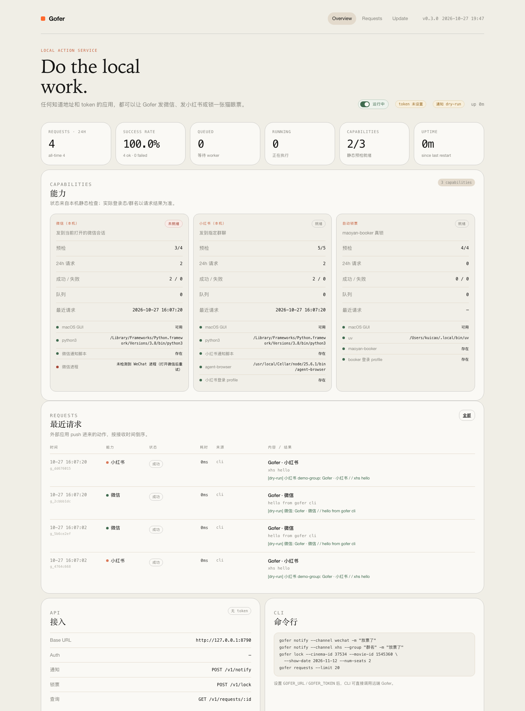

# Gofer

本地动作服务：只要知道地址和 token，任何应用都可以让 Gofer 执行：

- **微信（本机）**：发到当前打开的微信会话
- **小红书（本机）**：发到指定群聊
- **自动锁票**：通过 `maoyan-booker` 真锁猫眼座位

Gofer 是一个独立的 Rust 服务（axum + SQLite + Askama），自带 HTTP API、CLI 和 Web 面板。
它不依赖 ticket-tracker 或任何监控服务；监控服务只把它当作一个普通的投递目标。
面板支持管理员登录、运行时 token 生成/轮转、微信/小红书测试发送，以及**不提交订单**的锁票演示。



---

## 目录

- [架构](#架构)
- [新 Mac 安装](#新-mac-安装)
- [配置 token 与启动](#配置-token-与启动)
- [面板登录与 token 管理](#面板登录与-token-管理)
- [常用命令](#常用命令)
- [HTTP API](#http-api)
- [服务绑定：iGlance / Services](#服务绑定iglance--services)
- [能力说明与安全边界](#能力说明与安全边界)
- [Web 面板](#web-面板)
- [面板测试与锁票演示](#面板测试与锁票演示)
- [macOS 后台运行 / Mac mini 部署](#macos-后台运行--mac-mini-部署)
- [环境变量](#环境变量)
- [数据与备份](#数据与备份)
- [升级](#升级)
- [故障排查](#故障排查)
- [项目结构](#项目结构)

---

## 架构

```text
外部应用 / 监控服务
        │  POST /v1/notify  /  POST /v1/lock  (token)
        ▼
┌──────────────────────────────┐
│ Gofer                        │
│  ├─ HTTP API + Web 面板      │
│  ├─ SQLite 请求历史/统计     │
│  ├─ notify worker（串行）    │
│  │    ├─ 微信脚本            │
│  │    └─ 小红书脚本          │
│  └─ lock worker（独立串行）  │
│       └─ maoyan-booker       │
└──────────────────────────────┘
```

设计约束：

- 请求异步：API 先返回 `202 + request_id`，结果写入 SQLite 并在面板展示。
- 微信和小红书共享 GUI 焦点，因此通知是单 worker 串行执行。
- 锁票使用独立 worker，不会阻塞通知。
- 不重试未完成请求；调用方可用 `request_id` 轮询，或通过 CLI `--wait` 等待。
- 锁票始终真锁；`--dry-run` 只影响微信/小红书通知。

---

## 新 Mac 安装

以下以全新 macOS（Apple Silicon 或 Intel）为例。命令默认使用 zsh。

### 0. 基础工具

安装 Xcode Command Line Tools：

```bash
xcode-select --install
```

安装 Homebrew（已安装可跳过）：

```bash
/bin/bash -c "$(curl -fsSL https://raw.githubusercontent.com/Homebrew/install/HEAD/install.sh)"
```

安装常用依赖：

```bash
brew install git node python uv
```

> `python3` 必须可执行，Gofer 的脚本通过 `python3 script.py ...` 调用。
> `uv` 用于运行 maoyan-booker。

### 1. 安装 Rust

```bash
curl --proto '=https' --tlsv1.2 -sSf https://sh.rustup.rs | sh
source "$HOME/.cargo/env"
rustc --version
cargo --version
```

要求 Rust 1.75+。Gofer 当前使用 edition 2021。

### 2. 安装 agent-browser（小红书需要）

```bash
npm install -g agent-browser
agent-browser --version
```

如果 `agent-browser` 不在 PATH：

```bash
npm prefix -g
# 把 <prefix>/bin 加进 ~/.zshrc 的 PATH
```

### 3. 安装并登录 maoyan-booker（锁票需要）

```bash
mkdir -p ~/Applications
cd ~/Applications
git clone https://github.com/kuicao55/maoyan-booker.git
cd maoyan-booker

uv sync
uv run playwright install chromium
```

首次登录猫眼（会打开 headed 浏览器，扫码登录）：

```bash
uv run python booker.py --cinema-id 37534
```

登录态保存在 `~/.maoyan-booker-profile/`，**不要删除**。
Gofer 使用这个仓库提供的 **uv / Playwright 环境** 和登录 profile；真实锁票脚本是
Gofer 内置的 `gofer-booker.py`（随 Gofer 更新，不需要单独同步 `booker.py`）：

```text
~/Applications/maoyan-booker/      # uv / Playwright 环境
~/.maoyan-booker-profile/          # 登录态
```

如果环境放在别处：

```bash
export MAOYAN_BOOKER_DIR=/path/to/maoyan-booker
```

> Gofer 的 `scripts/gofer-booker.py` 是 `maoyan-booker/booker.py` 的 vendored 副本
> （包含数字行号兼容修复）。上游 booker 更新时，同步到该文件并重新发版即可。
> Gofer 的 Release 二进制会把这个脚本一并内置。

建议先用 booker 自己的 README 做一次 dry-run 选座验证。

### 4. 准备微信

- 安装并登录微信 macOS 版。
- 微信专用账号建议只有一个目标群，并置顶。
- 发送前**把微信停在目标群聊页面**；`wechat-notify-fast.py` 不会按群名切换会话，只对当前打开的会话操作。
- 首次使用需在「系统设置 → 隐私与安全性 → 辅助功能 / 自动化」中允许运行 Gofer 的终端或进程控制微信。
- 微信进程名通常是 `WeChat`；Gofer 的 `/health` 会用 `pgrep -x WeChat` 检查。

### 5. 登录小红书 profile

```bash
agent-browser close 2>/dev/null || true
agent-browser --headed --profile ~/.agent-browser/profiles/xiaohongshu \
  open https://www.xiaohongshu.com/explore
```

在弹出的浏览器里扫码登录，然后关闭浏览器。登录态保存在：

```text
~/.agent-browser/profiles/xiaohongshu/
```

session 过期后重复上述步骤。
`xhs-notify.py` 默认使用这个 profile；群名必须和聊天列表显示的标题一致。

### 6. 安装 Gofer

#### 方式 A：Release 二进制（推荐，支持面板一键更新）

Release 二进制内置通知 / 演示 / 真实锁票脚本和面板 CSS/JS，后续面板更新只需要替换二进制。

```bash
ARCH=$(uname -m)
case "$ARCH" in
  arm64)  ASSET=aarch64-apple-darwin ;;
  x86_64) ASSET=x86_64-apple-darwin ;;
esac
mkdir -p ~/Applications/Gofer
cd ~/Applications/Gofer
curl -fL -o "gofer-$ASSET" \
  "https://github.com/kuicao55/Gofer/releases/latest/download/gofer-$ASSET"
curl -fL -o SHA256SUMS \
  "https://github.com/kuicao55/Gofer/releases/latest/download/SHA256SUMS"
grep "gofer-$ASSET" SHA256SUMS | shasum -a 256 -c -
mv "gofer-$ASSET" gofer
chmod +x gofer
xattr -d com.apple.quarantine gofer 2>/dev/null || true
./gofer --version
```

> 不需要复制 `scripts/` 或 `web/`；二进制启动时会释放到
> `~/.local/state/gofer/runtime/v<version>/`。`GOFER_SCRIPTS_DIR` / `GOFER_WEB_DIR`
> 只用于显式覆盖。

#### 方式 B：从源码编译（开发 / 调试）

```bash
mkdir -p ~/Applications
cd ~/Applications
git clone https://github.com/kuicao55/Gofer.git
cd Gofer

cargo build --release --locked
./target/release/gofer --version
```

可选：把 CLI 安装到 PATH：

```bash
cargo install --path . --locked
gofer --version
```

> 首次编译需要几分钟（tokio / axum / sqlx / reqwest 等）。
> `scripts/` 已带 vendored 的 `wechat-notify-fast.py`、`xhs-notify.py`、
> `gofer-seat-demo.py` 和 `gofer-booker.py`，构建时会编进二进制。
> 默认使用内置副本；如果开发时要实时修改仓库 `scripts/` / `web/` 而不重建，
> 启动前 `export GOFER_SCRIPTS_DIR=$PWD/scripts GOFER_WEB_DIR=$PWD/web`。

### 7. 启动并检查

```bash
cd ~/Applications/Gofer
# Release 安装
./gofer serve --bind 127.0.0.1:8790 --db ~/.local/state/gofer/gofer.db

# 源码编译
# ./target/release/gofer serve --bind 127.0.0.1:8790 --db ~/.local/state/gofer/gofer.db
```

打开 <http://127.0.0.1:8790>。

另一个终端检查：

```bash
curl -s http://127.0.0.1:8790/health | python3 -m json.tool
./target/release/gofer health
```

你应该看到：

```json
{
  "ready": {
    "wechat": true,
    "xhs": true,
    "lock": true,
    "demo": true
  }
}
```

如果微信没打开，`wechat` 会是 `false`，但服务本身仍然正常运行。

> 首次打开面板会跳到 `/setup`，先创建管理员密码；之后到 **Settings** 生成 API token 并复制给调用方。
> 面板登录密码和 API token 是两套凭据。

---

## 配置 token 与启动

### 生成 token

本机联调可以不设置 token；如果要给其他机器/应用调用，**必须设置 token**：

```bash
openssl rand -hex 32
```

把输出保存到安全位置，例如 macOS Keychain 或密码管理器。

### 前台启动（带 token）

```bash
cd ~/Applications/Gofer
GOFER_TOKEN='你的随机token' \
  ./target/release/gofer serve \
  --bind 127.0.0.1:8790 \
  --db ~/.local/state/gofer/gofer.db
```

### 后台启动（推荐日常使用）

```bash
cd ~/Applications/Gofer
GOFER_TOKEN='你的随机token' ./start-gofer.sh start
./start-gofer.sh status
./start-gofer.sh logs
./start-gofer.sh stop
```

`start-gofer.sh` 使用：

- 二进制：优先 `./gofer`（Release 安装），否则 `target/release/gofer`（源码）；可用 `GOFER_BIN` 覆盖
- 监听：`GOFER_BIND`，默认 `127.0.0.1:8790`
- 数据库：`GOFER_DB`，默认 `~/.local/state/gofer/gofer.db`
- PID：`~/.local/state/gofer/gofer.pid`
- 日志：`~/.local/state/gofer/gofer.log`

重启：

```bash
GOFER_TOKEN='你的随机token' ./start-gofer.sh restart
```

> 如果启用了 token，所有 `/v1/notify`、`/v1/lock`、`/v1/requests*`、`/v1/stats`
> 请求都必须带 token；`/health` 和面板仍然公开。

### 真实验证 vs dry-run

```bash
# 只模拟微信/小红书通知，不操作 GUI；锁票仍然真锁
./target/release/gofer serve --dry-run
```

建议第一次安装时用 `--dry-run` 验证 Gofer 本身，再单独验证真实脚本。

---

## 面板登录与 token 管理

### 首次设置

首次启动后打开 <http://127.0.0.1:8790>，会跳到 `/setup` 创建管理员密码（至少 8 位）。这个密码只用于登录面板，和 API token 是两套凭据：

- **管理员密码**：浏览器面板登录；Argon2 哈希存 SQLite。
- **API token**：其他应用调用 `/v1/*`；可在 Settings 查看、生成、轮转。

首次设置只允许在 loopback bind 或已设置 `GOFER_ADMIN_PASSWORD` 时进行，避免远程抢注。

### 登录 / 登出

- `/login` 登录；右上角“退出”清除 7 天会话 cookie。
- 会话使用 HMAC 签名 cookie（`HttpOnly; SameSite=Strict`），重启后仍然有效（session secret 存在 SQLite）。
- 面板所有页面和操作都需要登录；`/health`、`/v1/*` 不受面板 cookie 影响。

### 查看、生成、轮转 token

Settings 页面会显示：

- 当前 API 地址（`GOFER_PUBLIC_URL`，否则当前访问 Host）；
- 完整 API token、来源、上次轮转时间；
- 可直接复制的 `GOFER_URL` / `GOFER_TOKEN` 块。

点击“生成 / 轮转 token”后：

- 新 token 立即写入 SQLite 并更新内存；旧 token 下一个请求立即返回 401。
- 面板会话不受影响；其他应用需要换用新 token。
- 重启后新 token 仍然生效。

优先级：**面板保存的 token > `GOFER_TOKEN` 环境变量**。如果要把 token 交回 plist 管理，在 Settings 点“回退到 GOFER_TOKEN”（只有存在 env token 时显示）。

### 忘记管理员密码

在 plist/启动环境里设置 `GOFER_ADMIN_PASSWORD`（至少 8 位）并重启。启动时会校验；不匹配则重新哈希、写回 SQLite、轮换 session secret（所有旧会话失效）。之后可以移除该环境变量，数据库里的新密码继续有效。

### 安全边界

- token 明文存在 SQLite（为了始终可在面板查看），数据库文件权限 0600；备份数据库时按敏感数据保护。
- 面板默认只监听 `127.0.0.1`。远程访问建议 Tailscale / SSH 隧道；不要把面板直接暴露公网。
- 首次启动时如果没有任何管理员密码，且 bind 不是 loopback，Gofer 会拒绝启动。
- 反向代理终止 TLS 时设置 `GOFER_COOKIE_SECURE=true`。
- 面板 POST 带 SameSite cookie 和 Origin/Host 校验；仍建议只给可信网络访问。

## 常用命令

```bash
# 微信：发到当前打开的微信会话
gofer notify --channel wechat --title "放票了" -m "19:30 IMAX 有座"

# 小红书：发到指定群
gofer notify --channel xhs --group "群名" \
  --title "放票了" -m "19:30 IMAX 有座"

# 等待执行结果
gofer notify --channel wechat -m "hello" --wait

# 锁票
gofer lock \
  --cinema-id 37534 \
  --movie-id 1545360 \
  --show-date 2026-11-12 \
  --time-range "19:00-22:00" \
  --num-seats 2 \
  --imax-only

# 锁票等待结果（最长 5 分钟）
gofer lock ... --wait

# 查询
gofer requests --limit 20
gofer requests --json --limit 50
gofer status
gofer health
gofer health --json

# 给 iGlance 的绑定 manifest（不需要服务在运行）
gofer manifest
gofer manifest --base-url http://127.0.0.1:8790
```

远端调用：

```bash
export GOFER_URL=http://127.0.0.1:8790
export GOFER_TOKEN='你的随机token'

gofer notify --channel wechat -m "hi"
```

> `gofer lock` 是**真锁**。确认 `GOFER_URL` 指向的是测试还是生产实例。
> 联调 booker 请用 `MAOYAN_BOOKER_DIR` 指向 mock 项目，而不是依赖 `--dry-run`。

---

## HTTP API

所有 API 返回 JSON。异步请求返回 `202`：

```json
{"request_id":"g_ab12cd34","status":"queued","capability":"wechat"}
```

### 鉴权

当前 token 以面板 **Settings** 显示的为准（面板轮转后数据库值优先于 `GOFER_TOKEN`）。设置了 token 时，任一方式即可：

```http
X-Gofer-Token: <token>
X-Agent-Token: <token>
Authorization: Bearer <token>
```

API token 只能调用 `/v1/*`，不能登录面板；面板登录 cookie 也不能调用 API。

### 微信通知

```bash
curl -X POST http://127.0.0.1:8790/v1/notify \
  -H 'Content-Type: application/json' \
  -H 'X-Gofer-Token: change-me' \
  -d '{
    "channel": "wechat",
    "title": "放票了",
    "message": "19:30 IMAX 有座",
    "source": "my-app"
  }'
```

### 小红书通知

```bash
curl -X POST http://127.0.0.1:8790/v1/notify \
  -H 'Content-Type: application/json' \
  -H 'X-Gofer-Token: change-me' \
  -d '{
    "channel": "xhs",
    "group": "群名",
    "title": "放票了",
    "message": "19:30 IMAX 有座",
    "source": "my-app"
  }'
```

`group` 也可以放在 `config.group` 里。

### 锁票

```bash
curl -X POST http://127.0.0.1:8790/v1/lock \
  -H 'Content-Type: application/json' \
  -H 'X-Gofer-Token: change-me' \
  -d '{
    "movie_id": 1545360,
    "cinema_id": "37534",
    "show_date": "2026-11-12",
    "time_range": "19:00-22:00",
    "num_seats": 2,
    "imax_only": true,
    "seats": [],
    "headless": true,
    "source": "my-app"
  }'
```

可选字段：

- `watch_id` / `movie_name` / `cinema_name` / `event_id`：只用于展示和回调上下文。
- `seats`：手动指定座位，例如 `["5排6座"]`；为空时智能选座。
- `headless`：默认 true；调试可传 false。
- `callback_url`：锁票完成后 best-effort POST 结果。

### 查询请求

```bash
curl -H 'X-Gofer-Token: change-me' \
  http://127.0.0.1:8790/v1/requests/<request_id>
```

状态：

- `queued`：已接收，等待 worker
- `running`：执行中
- `ok`：成功
- `failed`：失败，`error` 有原因

### 其他端点

| 方法 | 路径 | 说明 |
|---|---|---|
| GET | `/health` | 服务健康、能力静态检查、队列长度 |
| GET | `/v1/stats` | 24h 总数/成功/失败、按能力统计 |
| GET | `/v1/requests?limit=50` | 最近请求 |
| GET | `/v1/requests/:id` | 单个请求 |
| POST | `/v1/notify` | 微信/小红书 |
| POST | `/v1/lock` | 锁票 |
| GET | `/v1/service` | 服务描述 + 实时内存 + 控制命令 |
| GET | `/v1/service/memory` | 仅内存快照 |
| POST | `/v1/service/pause` | 暂停接收新请求 |
| POST | `/v1/service/resume` | 恢复接收新请求 |
| POST | `/v1/service/toggle` | 切换暂停/恢复 |
| POST | `/v1/service/stop` | 停止 Gofer 进程 |

兼容旧路径 `/notify`、`/lock`，方便替换旧 agent。`/v1/service*` 与 `/api/v1/service*` 等价。

---

## 服务绑定：iGlance / Services

iGlance 的绑定可以很简单：只填 **服务名称、启动命令、API token**。服务启动后，
Gofer 会用一行 manifest 告诉 iGlance 自己的地址、内存接口和关闭接口。

### 最简绑定流程

1. iGlance 里新增服务：
   - 名称：`Gofer`
   - 启动命令：`/Users/me/Applications/Gofer/start-gofer.sh start --manifest`
   - token：Gofer 面板 Settings 里的 API token（没设置 token 可留空）
2. 点击「启动」，iGlance 执行命令并捕获 stdout。
3. Gofer 就绪后输出一行：

   ```text
   IGLANCE_SERVICE_MANIFEST {"schema":"iglance.service.v1","service":{"id":"gofer","name":"Gofer","version":"0.5.1"},"base_url":"http://127.0.0.1:8790","auth":{"header":"X-Gofer-Token","type":"header"},"endpoints":{"health":"/health","panel":"/","status":"/api/v1/service","memory":"/api/v1/service/memory","pause":"/api/v1/service/pause","resume":"/api/v1/service/resume","toggle":"/api/v1/service/toggle","stop":"/api/v1/service/stop"}}
   ```

4. iGlance 解析 `base_url` 和 `endpoints`，自动得到：
   - 状态/内存：`GET <base_url>/api/v1/service`
   - 关闭：`POST <base_url>/api/v1/service/stop`
   - 暂停/恢复：`POST <base_url>/api/v1/service/pause` / `resume`
   - 网页面板：`endpoints.panel`（相对 `base_url`；Gofer 为 `/`）
5. iGlance 把 manifest 缓存到绑定里；以后服务离线时，仍然用同一条启动命令启动。

**token 不放在 manifest 里**，由 iGlance 自己按绑定保存。没有 token 时请求不需要鉴权；
有 token 时所有 `/api/v1/service*` 请求带 `X-Gofer-Token: <token>`。

iGlance 执行启动命令时要捕获 stdout，逐行找 `IGLANCE_SERVICE_MANIFEST ` 前缀；
`start-gofer.sh` 最多等待健康检查 10 秒，建议 iGlance 的启动超时设为 15 秒以上。

如果 Gofer 已经在运行，`GET /api/v1/service` 的 `controls.start` 也会给出当前环境对应的
启动命令和 `manifest_command`，iGlance 可以用于首次绑定时自动填充。

### 服务描述

```bash
curl -H 'X-Gofer-Token: change-me' \
  http://127.0.0.1:8790/api/v1/service
```

关键字段：

```json
{
  "schema": "iglance.service.v1",
  "ok": true,
  "service": {
    "id": "gofer",
    "name": "Gofer",
    "version": "0.5.1",
    "kind": "headless-service"
  },
  "state": "running",
  "paused": false,
  "pid": 12345,
  "uptime_sec": 3600,
  "urls": {
    "base": "http://127.0.0.1:8790",
    "display": "http://127.0.0.1:8790",
    "health": "http://127.0.0.1:8790/health",
    "panel": "http://127.0.0.1:8790/"
  },
  "auth": {
    "header": "X-Gofer-Token",
    "token_required": true
  },
  "memory": {
    "available": true,
    "source": "ps-rss",
    "total_rss_bytes": 435896320,
    "total_processes": 13,
    "groups": [
      { "id": "service", "label": "Gofer", "rss_bytes": 12603392, "processes": 1, "pids": [12345] },
      { "id": "workers", "label": "Workers", "rss_bytes": 0, "processes": 0, "pids": [] },
      { "id": "xhs_browser", "label": "小红书浏览器", "rss_bytes": 423292928, "processes": 12, "pids": [12346] },
      { "id": "booking_browser", "label": "订票浏览器", "rss_bytes": 0, "processes": 0, "pids": [] },
      { "id": "wechat", "label": "微信", "rss_bytes": 0, "processes": 0, "pids": [] }
    ],
    "gofer": { "rss_bytes": 12603392, "processes": 1, "pids": [12345] },
    "workers": { "rss_bytes": 0, "processes": 0, "pids": [] },
    "xhs_browser": { "rss_bytes": 423292928, "processes": 12, "pids": [12346] },
    "booking_browser": { "rss_bytes": 0, "processes": 0, "pids": [] },
    "wechat": { "rss_bytes": 0, "processes": 0, "pids": [] }
  },
  "controls": {
    "pause": { "method": "POST", "path": "/api/v1/service/pause" },
    "resume": { "method": "POST", "path": "/api/v1/service/resume" },
    "stop": { "method": "POST", "path": "/api/v1/service/stop" },
    "start": {
      "type": "command",
      "shell": "/bin/zsh",
      "command": "'/Users/me/Applications/Gofer/start-gofer.sh' start --manifest",
      "binding_command": "'/Users/me/Applications/Gofer/start-gofer.sh' start --manifest",
      "manifest_command": "'/Users/me/Applications/Gofer/gofer' manifest --base-url 'http://127.0.0.1:8790'",
      "manifest_prefix": "IGLANCE_SERVICE_MANIFEST",
      "source": "start-gofer.sh"
    }
  }
}
```

内存口径：

| 字段 | 内容 |
|---|---|
| `gofer` | Gofer 主进程 |
| `workers` | Gofer 派生的 python / uv / 通知 / 锁票进程 |
| `xhs_browser` | 常驻的 `agent-browser` daemon 与小红书 Chrome（含 helper） |
| `booking_browser` | 锁票/演示使用的 Playwright Chromium |
| `wechat` | 微信 App 的全部进程（含 helper）；只要微信在运行就计入，不管是否由 Gofer 启动 |
| `total_rss_bytes` | 以上各项之和 |

`memory.groups` 是给 iGlance 的通用渲染入口：每个元素有 `id`、`label`、`rss_bytes`、
`processes`、`pids`。Gofer 同时保留 `gofer/workers/xhs_browser/...` 这些命名分组作为兼容字段；
其他服务只要返回同样结构的 `groups`，iGlance 不需要为它写专用代码。

数值来自一次 `ps` 快照的 RSS 求和，单位是字节。RSS 对共享内存会重复计算，因此它是
**估算值**，适合展示趋势和相对大小，不等同于「物理内存占用」。采集失败时
`memory.available=false`，`error` 给出原因，服务本身不受影响。

### 网页面板

如果服务带 Web 面板，manifest 的 `endpoints.panel` 给出相对 `base_url` 的路径，运行时
`GET /api/v1/service` 的 `urls.panel` 给出完整地址。Gofer 的面板就在根路径 `/`。

iGlance 可以在服务 `running` / `paused` 时显示「Open Panel」按钮，用默认浏览器打开；
没有 `panel` 字段的服务不显示按钮。打开面板仍需管理员登录，iGlance 不应自动登录或把
token 放进 URL。

### 暂停 / 恢复 / 停止

```bash
# 暂停：不再接受新的 notify/lock 请求，进程和浏览器都保留
curl -X POST -H 'X-Gofer-Token: change-me' \
  http://127.0.0.1:8790/api/v1/service/pause

# 恢复
curl -X POST -H 'X-Gofer-Token: change-me' \
  http://127.0.0.1:8790/api/v1/service/resume

# 停止：默认 cleanup=true，会关闭小红书浏览器并结束 Gofer 的 worker
curl -X POST -H 'X-Gofer-Token: change-me' \
  'http://127.0.0.1:8790/api/v1/service/stop?cleanup=true'
```

- `stop` 先返回 `202`，随后清理并退出；通常 1 秒内完成，`agent-browser close` 最长等待 4 秒。
  调用方应把连接失败视为已停止。
- `cleanup=true`（默认）会执行 `agent-browser close` 并终止 Gofer 子进程；微信不会被关闭。
- 只想停止 Gofer 进程、保留浏览器时用 `?cleanup=false`。
- 停止不会把「暂停」写进数据库；下次启动仍保持停止前的暂停状态。

### 启动命令

Gofer 完全停止后不可能再响应 HTTP，所以启动一定是一条本地命令。常用的三种写法：

```bash
# start-gofer.sh（推荐，手动绑定时直接填这一条）
/Users/me/Applications/Gofer/start-gofer.sh start --manifest

# 分别执行：先启动，再只打印 manifest
/Users/me/Applications/Gofer/start-gofer.sh start
/Users/me/Applications/Gofer/gofer manifest --base-url http://127.0.0.1:8790

# launchd（plist 已安装时）
launchctl bootstrap gui/$(id -u) ~/Library/LaunchAgents/com.kuicao.gofer.plist
/Users/me/Applications/Gofer/gofer manifest --base-url http://127.0.0.1:8790
```

- `gofer manifest` 不需要服务正在运行，只根据 `--base-url`（或 `--bind` / `GOFER_BIND`）打印 manifest。
- `start-gofer.sh start --manifest` 会在健康检查通过后自动打印 manifest；服务已在运行时也会直接打印。
- 自定义 `GOFER_START_COMMAND` 如果不会输出 manifest，iGlance 可以继续执行
  `controls.start.manifest_command`，或者退化为手动填写 `base_url` 后直接轮询。
- `controls.start` 的来源优先级：`GOFER_START_COMMAND` → launchd → `start-gofer.sh`。
- iGlance 绑定直接使用 `controls.start.binding_command`：它保证「启动 + 输出 manifest」在一条命令里完成。
- 用 launchd 常驻时，请使用 `controls.start.command` 里的 `launchctl` 版本，不要再用
  `start-gofer.sh` 启动，否则可能启动第二个 Gofer 实例。

> `controls.start` 含本机路径和启动方式，只应暴露给可信的本地面板；不要把 Gofer
> 的 token 和这个接口暴露到不可信网络。

---

## 能力说明与安全边界

### 微信（本机）

- **没有群名参数**：固定发到当前打开的微信会话。
- 发送前请把微信停在目标群。
- 依赖 macOS 辅助功能/自动化权限。
- `/health` 只能检查 `WeChat` 进程是否存在，不能确认当前会话、登录状态或脚本权限。
- `--dry-run` 时只打印，不操作微信。

### 小红书（本机）

- 每个请求必须提供 `group`（群标题），必须和聊天列表完全一致。
- 依赖 `agent-browser` 和 `~/.agent-browser/profiles/xiaohongshu` 登录态。
- `/health` 只检查脚本、`agent-browser` 和 profile 目录存在；不能确认 cookie 未过期。
- session 过期时按 [登录小红书 profile](#5-登录小红书-profile) 重新扫码。

### 自动锁票

- 依赖 `uv`、`maoyan-booker` 提供的 uv/Playwright 环境，以及 `~/.maoyan-booker-profile`。
- 锁票脚本 `gofer-booker.py` 内置在 Gofer 中，随 Gofer release 更新；`maoyan-booker` 仓库只作为运行环境。
- 始终 `--confirm` 真锁；没有 Gofer 级别的 dry-run。
- 锁成功后需要在 15 分钟内到猫眼 App 付款。
- `/health` 只做依赖检查，不会真的锁票。
- 结果码：`Ok`、`ShowGone`、`Error`、`Timeout`、`Unknown`。
- `callback_url` 是 best-effort，不保证送达；以面板/SQLite 状态为准。
- 可选 Discord webhook 通知（预检项里配置）；成功/失败都会发送，best-effort，不影响锁票结果。

### Gofer 不会做什么

- 不会自动重试失败请求。
- 不会持久化未执行队列；进程重启时 queued/running 请求不会自动恢复。
- 不会修改微信/小红书/猫眼页面以外的系统状态。
- 面板需要管理员登录，但仍建议只监听本机或放在受信任的内网/SSH 隧道后面（默认无 TLS）。

---

## Web 面板

访问 <http://127.0.0.1:8790>，首次会跳转 `/setup` 创建管理员密码。

- **Overview**：三项能力、预检状态、24h 请求量/成功率、队列、最近请求。
  每张能力卡片下方有对应入口：微信 / 小红书卡片 → 测试页面；自动锁票卡片 → 锁票演示。
  自动锁票预检项里包含 Discord 通知：未配置为红色，已配置为绿色，点“配置 / 修改”打开设置。
- **Requests**：完整请求历史（最多 200 条），含 request_id、耗时、来源、结果/错误。
- **Settings**：查看 / 生成 / 轮转 API token，复制“地址 + token”，以及复制 iGlance 绑定信息
  （名称、启动命令、token）。
- **Update**：检查并安装 GitHub Release。
- 顶部开关可暂停/恢复 Gofer；暂停后 `/v1/notify` 和 `/v1/lock` 返回 `503`，
  已在执行的任务会完成，状态会持久化到 SQLite。
- 面板需要管理员登录；`/health` 保持公开。
- Overview / Requests 每 5 秒刷新；Tests / Demo 的状态片段每 2 秒刷新。

如果页面样式异常，检查 URL 中的 `app.css?v=...` 是否随版本更新，或强制刷新。

---

## 面板测试与锁票演示

### 微信 / 小红书测试

在 Overview 的微信 / 小红书能力卡片下方点“测试微信” / “测试小红书”进入 `/tests`
（也可以直接访问；页面内分 `#wechat` / `#xhs` 两段）：

- **微信**：消息发送到当前打开的微信会话。发送前请把微信停在目标群聊页面。
- **小红书**：填写与聊天列表完全一致的群名，以及标题 / 正文 / 链接。
- 默认**真实发送**；勾选“仅模拟”只演练，不操作 GUI。这个勾选会覆盖全局 `GOFER_DRY_RUN`。
- 请求走现有 notify worker，结果显示在页面和 `/requests`。
- 服务暂停时测试会被拒绝；通知队列满时返回错误。

### 锁票演示

在 Overview 的“自动锁票”能力卡片下方点“锁票演示”进入 `/demo`（也可以直接访问）：

- 默认从 `GOFER_DEMO_CITY_ID`（默认 10 = 上海）的猫眼影院列表随机选一家；
- 也可以手填影院 ID（跳过随机）和电影 ID（不填则让 booker 扫描该影院当天全部电影 / 场次）；
- 演示使用有头 Chromium，在 Mac mini 上打开；到选座页后保持浏览器打开；
- 面板显示阶段、实时日志和 `latest.png` 截图；
- 点击“停止演示”关闭浏览器；默认 600 秒超时。

**安全保证**：vendored 演示脚本来自 TixDash（MIT，commit `250b9fa`，许可见 `scripts/THIRD_PARTY_NOTICES.md`），已删除所有确认 / 提交代码路径；Gofer 构造参数时从不传 `--confirm`。脚本还会在选座后禁用“确认选座”元素的指针事件，防止误点。演示只写 `lock_demo` 请求记录，`result_json.order_submitted=false`。

依赖：

- `~/Applications/maoyan-booker` 的 uv / Playwright 环境（`uv sync` + `playwright install chromium`）；
- `~/.maoyan-booker-profile` 已登录；过期时演示会打开有头浏览器等待扫码（最长 300s）；
- 真实锁票和演示共用 profile，Gofer 用互斥锁串行执行，长演示会延迟真实锁票；
- 随机影院当天没有场次时，页面提示失败；可换城市或手填影院 ID 重试。

> 演示会在 Mac mini 的显示器上打开浏览器。远程访问时可用面板截图观察；也可以 VNC / 屏幕共享。

### Discord 通知（自动锁票）

Overview 的“自动锁票”预检项里会显示 **Discord 通知**：

- 未配置 = 红色“未配置”；已配置 = 绿色“已配置”；
- 点该行的 **配置 / 修改** 打开设置，不是独立按钮；
- 粘贴 `https://discord.com/api/webhooks/...`（也支持 `discordapp.com` / `*.discord.com`）；
- 保存后可点“发送测试通知”；
- 真实锁票结束（成功或失败）会 POST 一条 embed 到该 webhook；
- 演示选座**不会**发送 Discord 通知；
- 通知是 best-effort，失败只写 Gofer 日志，锁票结果仍以请求记录为准；
- Webhook URL 含 token，保存在 `settings` 表，按敏感数据保护；只允许 Discord 域名，避免被当成任意 URL 转发器。

---

## 面板更新

登录面板后访问 `http://127.0.0.1:8790/update`：

1. 检查 GitHub Releases 最新版本；
2. 显示 release notes；
3. 下载当前 Mac 架构的 `gofer-<arch>-apple-darwin`；
4. 校验 `SHA256SUMS`；
5. 替换二进制并重启。

**Release 二进制内置运行时代码**：通知脚本、演示脚本、真实锁票脚本、面板 CSS/JS 都编译进
二进制，启动时释放到 `~/.local/state/gofer/runtime/v<version>/`。因此面板更新替换二进制后，
重启会同时使用新的脚本和面板资源，不需要再 `git pull` / 手动复制 `scripts/`、`web/`。

> 如果你显式设置了 `GOFER_SCRIPTS_DIR` / `GOFER_WEB_DIR`，Gofer 会使用那些外部目录，面板更新
> 不会覆盖它们。要享受一键完整更新，请不要设置这两个变量（或删除旧 plist 里的对应项）。

面板更新需要先登录（0.4.0 起面板有管理员鉴权）。Gofer 仓库现在是公开仓库，通常不需要 token。
如果遇到 GitHub 限流，可以配置只读 token：

```bash
export GOFER_UPDATE_TOKEN='github_pat_...'   # contents: read，可选
```

launchd 模板里设置 `GOFER_SUPERVISED=launchd`，这样更新后由 KeepAlive 拉起新进程。
用 `start-gofer.sh` 启动时不需要 supervised，Gofer 会用重启助手接管 PID/日志。

发版：

```bash
git tag v0.5.1
git push origin v0.5.1
```

Release 资产：

```text
gofer-aarch64-apple-darwin
gofer-x86_64-apple-darwin
SHA256SUMS
```

Release 二进制内置 `scripts/` 和 `web/`，启动时释放到 state 目录，所以单文件即可运行。
显式覆盖仍然支持（例如自定义通知脚本）：

```bash
export GOFER_SCRIPTS_DIR=/path/to/Gofer/scripts
export GOFER_WEB_DIR=/path/to/Gofer/web
```

默认（Release 和源码）都使用内置资源。源码开发如果要实时使用仓库目录，显式 export
`GOFER_SCRIPTS_DIR` / `GOFER_WEB_DIR`；否则修改脚本或 CSS 后需要重新构建二进制。

## macOS 后台运行 / Mac mini 部署

### 方案 A：`start-gofer.sh`（最简单）

```bash
cd ~/Applications/Gofer
GOFER_TOKEN='...' ./start-gofer.sh start --build
```

适合本机日常使用。登录后手动启动，或写进登录项。`GOFER_TOKEN` 可以省略，启动后到面板
`/setup` 创建管理员密码，再在 Settings 生成 token。

### 方案 B：launchd（推荐 Mac mini 常驻）

模板：`deploy/launchd/com.kuicao.gofer.plist`

模板默认指向 Release 安装路径 `~/Applications/Gofer/gofer`；如果是源码编译，
把 `ProgramArguments` 改成 `~/Applications/Gofer/target/release/gofer`。
不要设置 `GOFER_SCRIPTS_DIR` / `GOFER_WEB_DIR`，否则会覆盖内置资源。

先改成你的实际路径、用户名；token 可以留空，首次打开面板时完成设置：

```bash
cp deploy/launchd/com.kuicao.gofer.plist ~/Library/LaunchAgents/
# 编辑 ~/Library/LaunchAgents/com.kuicao.gofer.plist
```

安装 / 启动：

```bash
launchctl bootstrap gui/$(id -u) ~/Library/LaunchAgents/com.kuicao.gofer.plist
launchctl kickstart -k gui/$(id -u)/com.kuicao.gofer
```

查看状态 / 日志：

```bash
launchctl print gui/$(id -u)/com.kuicao.gofer | head -40
tail -f ~/Library/Logs/gofer.log
```

卸载：

```bash
launchctl bootout gui/$(id -u) ~/Library/LaunchAgents/com.kuicao.gofer.plist
```

> 旧教程里的 `launchctl load/unload` 仍可用，但新版 macOS 建议用 `bootstrap/bootout`。

模板已设置 `GOFER_LAUNCHD_LABEL` 和 `GOFER_LAUNCHD_PLIST`。通过 `/api/v1/service/stop`
停止时，Gofer 会先 `launchctl bootout` 再退出，避免 `KeepAlive` 立刻拉起；iGlance 等外部
面板拿到的启动命令会使用 `launchctl bootstrap` 重新加载同一份 plist。若你改了 label 或
plist 路径，请同步修改这两个环境变量，否则面板重启会失败。

首次启动后打开面板完成 `/setup`，再到 Settings 生成 token。若要让 Gofer 绑定非 loopback
地址且还没设置过管理员密码，请先在 `127.0.0.1` 上完成初始化，或在 plist 里设置
`GOFER_ADMIN_PASSWORD` 后再启动。

### Mac mini 专项 checklist

Mac mini 更适合长期运行，但 GUI 自动化有几个硬性条件：

1. **用户登录会话**
   - WeChat / agent-browser 需要已登录的 macOS 用户会话。
   - 重启后如果没有自动登录，launchd user agent 不会在登录前运行。
   - 建议使用专用用户 + 自动登录，或重启后手动登录一次。
   - 如果开启 FileVault，自动登录会被禁用；需要自己权衡安全与无人值守。

2. **禁止睡眠**
   ```bash
   sudo pmset -a sleep 0 disksleep 0 displaysleep 10
   pmset -g
   ```
   - 显示器可以睡眠；系统不要睡眠。
   - 也可以外层用 `caffeinate -i -s`，但更推荐 `pmset`。
   - 不要依赖锁屏后的 headed GUI 流程；小红书登录恢复需要可见会话。

3. **GUI 权限**
   - 系统设置 → 隐私与安全性 → 辅助功能：允许运行 Gofer 的终端 / launchd 进程 / `osascript`。
   - 自动化：允许 Terminal / Gofer 控制微信。
   - 修改权限后通常需要重新登录或重启进程。

4. **微信保持登录**
   - 微信专用账号；目标群置顶。
   - 不要把微信退出登录，否则 `/health` 仍显示进程存在，但发送会失败。

5. **小红书 session**
   - profile 在 `~/.agent-browser/profiles/xiaohongshu`。
   - session 过期后需要重新 headed 扫码；无人值守机器上应定期检查。

6. **锁票 session**
   - `~/.maoyan-booker-profile` 不要删除。
   - 定期验证 booker 登录态。

7. **网络与安全**
   - 默认只绑定 `127.0.0.1`，只允许本机调用。
   - 如果监控服务在另一台机器：
     - 推荐 SSH 隧道 / Tailscale，仍然让 Gofer 绑 `127.0.0.1`；
     - 或绑定内网地址并**务必启用 token + 防火墙**，只允许监控服务器 IP。
   - 不要把 8790 直接暴露到公网；面板需要登录，但默认仍是明文 HTTP。

### 远程监控服务连接示例

在监控机器上建 SSH 隧道：

```bash
ssh -N -L 8790:127.0.0.1:8790 user@mac-mini
```

监控服务的 Settings / watch 渠道里填：

```text
Gofer URL:   http://127.0.0.1:8790
Gofer token: 与 Gofer 的 GOFER_TOKEN 一致
```

监控服务不会探活 Gofer；Gofer 离线只会在监控事件里记录一次投递失败。

---

## 环境变量

| 变量 | 作用 | 默认 |
|---|---|---|
| `GOFER_BIND` | 监听地址 | `127.0.0.1:8790` |
| `GOFER_DB` | SQLite 路径 | `~/.local/state/gofer/gofer.db` |
| `GOFER_TOKEN` | 启动时的 API token；面板轮转后数据库值优先；空=不校验 | 空 |
| `GOFER_ADMIN_PASSWORD` | 可选；面板管理员密码重置（至少 8 位），启动时写回数据库并轮换会话 | 空 |
| `GOFER_PUBLIC_URL` | 可选；面板里展示的对外地址 | 空（用请求 Host） |
| `GOFER_COOKIE_SECURE` | TLS 反向代理时给会话 cookie 加 `Secure` | `false` |
| `GOFER_DRY_RUN` | 仅通知 dry-run | `false` |
| `GOFER_LOCK_HEADLESS` | booker 默认 headless | `true` |
| `GOFER_RETENTION_DAYS` | 请求历史保留天数 | `30` |
| `GOFER_SCRIPTS_DIR` | 可选；覆盖内置脚本目录（release 默认用内置） | 内置 / 源码 `<repo>/scripts` |
| `GOFER_WEB_DIR` | 可选；覆盖内置面板静态资源目录 | 内置 / 源码 `<repo>/web` |
| `MAOYAN_BOOKER_DIR` | uv/Playwright 环境与 profile 目录；锁票脚本已内置 | `~/Applications/maoyan-booker` |
| `GOFER_DEMO_CITY_ID` | 演示随机影院的城市 ID | `10`（上海） |
| `GOFER_DEMO_CINEMA_ID` | 可选；固定演示影院 ID（跳过随机） | 空 |
| `GOFER_DEMO_MOVIE_ID` | 可选；固定演示电影 ID | 空 |
| `GOFER_DEMO_TIMEOUT_SECS` | 演示最长运行时间 | `600` |
| `GOFER_DEMO_PYTHON` | 可选；演示脚本使用的 Python（默认 booker `.venv` 或 `uv`） | 空 |
| `GOFER_UPDATE_TOKEN` | 可选；GitHub 只读 token，避免限流 | 空 |
| `GOFER_UPDATE_API_BASE` | 可选；GitHub API/镜像地址 | `https://api.github.com` |
| `GOFER_SUPERVISED` | `launchd` 时更新后由 launchd 重启；停止时也会先 bootout | 空 |
| `GOFER_START_COMMAND` | 服务描述里返回给 iGlance 的启动命令；覆盖自动发现 | 空 |
| `GOFER_START_SCRIPT` | 显式指定 `start-gofer.sh` 路径 | 自动发现 |
| `GOFER_LAUNCHD_LABEL` | launchd job label；用于停止/启动 | `com.kuicao.gofer` |
| `GOFER_LAUNCHD_PLIST` | launchd plist 路径；用于 `launchctl bootstrap` | `~/Library/LaunchAgents/<label>.plist` |
| `XHS_WEBHOOK` | 小红书 session 过期时发二维码的 Discord webhook（可选） | 空 |
| `GOFER_URL` | CLI 默认服务地址 | `http://127.0.0.1:8790` |

> `GOFER_DEMO_CMD` 是仅用于测试的隐藏覆盖项，生产环境不要设置。

---

## 数据与备份

默认数据库：

```text
~/.local/state/gofer/gofer.db
```

表：

- `requests`：每次请求的时间、能力、状态、耗时、来源、摘要、错误、payload。
- `settings`：管理员密码哈希、会话 secret、面板保存的 API token（明文）、轮转时间，
  以及可选的锁票 Discord webhook URL。
- `service_state`：暂停 / 恢复状态。

> 数据库包含管理员密码哈希和 API token。Gofer 会把 DB 文件设为 `0600`、状态目录设为 `0700`；
> 备份文件和演示截图（`~/.local/state/gofer/demo-screenshots`）也应按敏感数据处理。

备份（SQLite 在线备份）：

```bash
mkdir -p ~/Backups/gofer
sqlite3 ~/.local/state/gofer/gofer.db \
  ".backup '$HOME/Backups/gofer/gofer-$(date +%Y%m%d-%H%M%S).db'"
```

恢复：

```bash
./start-gofer.sh stop
cp ~/Backups/gofer/gofer-YYYYMMDD-HHMMSS.db ~/.local/state/gofer/gofer.db
./start-gofer.sh start
```

历史默认保留 30 天；可用 `--retention-days` / `GOFER_RETENTION_DAYS` 调整。

---

## 升级

### Release 安装（推荐）

登录面板 → **Update** → 安装最新版本。更新流程会下载并校验二进制、替换、重启；
内置的通知 / 演示 / 真实锁票脚本和面板 CSS/JS 会在重启时释放到 state 目录，因此
**Gofer 自己的运行时代码也一起更新**，不需要 `git pull` 或手动复制 `scripts/`、`web/`。

- SQLite migration 在启动时自动执行（0.4.0 新增 `settings` 表）。
- 升级前建议先备份数据库。
- 从 0.3.x 升到 0.4.0 后，第一次打开面板会跳到 `/setup` 创建管理员密码；已有 `GOFER_TOKEN` 仍然有效，可在 Settings 轮转或回退。
- 已保存到数据库的 token、session secret 和 Discord webhook 在升级 / 重启后继续生效。
- 如果设置了 `GOFER_SCRIPTS_DIR` / `GOFER_WEB_DIR`，面板更新不会覆盖这些外部目录；要使用内置资源请移除这两个变量。
- `maoyan-booker` 的 uv/Playwright 环境和 `~/.maoyan-booker-profile` 是外部运行时依赖，不由面板更新；必要时自行 `uv sync` / 重新登录。

### 源码开发

```bash
cd ~/Applications/Gofer
git pull --ff-only
cargo build --release --locked
./start-gofer.sh restart
```

源码模式默认也使用内置资源；改脚本 / CSS 后需要 `cargo build`（或 `start-gofer.sh start --build`）
重新嵌入。开发时想实时用仓库目录，启动前 export `GOFER_SCRIPTS_DIR` / `GOFER_WEB_DIR`。
如果使用 launchd：

```bash
launchctl kickstart -k gui/$(id -u)/com.kuicao.gofer
```

---

## 故障排查

### `gofer health` 显示 `wechat: false`

- 微信 App 没打开 → 打开并登录。
- 进程名不是 `WeChat` → `pgrep -fl -i wechat`；如果不同，需要调整 `capabilities.rs` 中的检查。
- 打开微信后立即重试；Gofer 每次 `/health` 都会重新检查。

### 微信显示就绪但发送失败

- 微信没有停在目标群聊页面。
- 没有辅助功能/自动化权限。
- 微信专用账号被切换或群名/置顶变化。
- 发送失败会在请求 `error` 和 Gofer 日志中显示脚本 stderr。

### 小红书 403 / 找不到群 / 登录过期

- 群名必须完全一致（含 emoji/空格）。
- 重新登录 profile：
  ```bash
  agent-browser close
  agent-browser --headed --profile ~/.agent-browser/profiles/xiaohongshu \
    open https://www.xiaohongshu.com/explore
  ```
- 检查 `agent-browser --version` 和 PATH。
- session 过期后脚本可能自动 headed 恢复；无人值守时要注意。

### 锁票立即失败

```bash
gofer health --json
```

检查：

- `uv`、`maoyan-booker 环境`、`lock_script`、`booker_profile` 是否 ok。
- `MAOYAN_BOOKER_DIR` 是否指向含 `pyproject.toml` / `.venv` 的 uv 环境目录。
- 锁票脚本是 Gofer 内置的 `gofer-booker.py`；源码开发时在 `scripts/`，Release 在
  `~/.local/state/gofer/runtime/v<version>/scripts/`。
- `~/.maoyan-booker-profile` 是否被删除。
- booker 是否还登录着；必要时重新运行一次 headed 登录。
- 查看 Gofer 请求的 `result_json` / `error`，里面包含 booker stdout/stderr 尾部。

### 端口被占用

```bash
lsof -nP -iTCP:8790 -sTCP:LISTEN
```

如果旧 `tt-agent` 还在：

```bash
launchctl bootout gui/$(id -u) ~/Library/LaunchAgents/com.kuicao.ticket-agent.plist 2>/dev/null || true
pkill -f 'tt-agent'
```

### 401

- API 请求没带或带错 token。当前 token 以 **Settings 页面显示的**为准（面板轮转后数据库值优先于 `GOFER_TOKEN`）。
- 轮转 token 后旧值立即失效，调用方需要更新。
- CLI 设置 `GOFER_TOKEN`；HTTP 带 `X-Gofer-Token` 或 `Authorization: Bearer`。
- 面板 cookie 不能用于 API；API token 也不能登录面板。

### 面板一直跳 `/setup` / 忘记管理员密码

- 首次部署还没有管理员密码；打开面板完成 `/setup`。
- 忘记密码：在启动环境里设置 `GOFER_ADMIN_PASSWORD`（至少 8 位）并重启；新密码会写回数据库，之后可移除该变量。
- 没有管理员密码且 bind 非 loopback 时服务会拒绝启动；先用 `127.0.0.1` 完成初始化。

### 面板 POST 返回 403

- Gofer 会校验 `Origin` / `Referer` 的 host 与 `Host` 一致。反向代理改写了 Host 时请保留原始 Host，或直接从面板原地址访问。
- `GOFER_PUBLIC_URL` 只影响展示和复制，不参与 Origin 校验。

### 演示提示依赖未就绪

- Release 二进制已内置 `gofer-seat-demo.py`；源码开发确认 `scripts/gofer-seat-demo.py` 存在。
- 确认 `maoyan-booker` 已 `uv sync` + `playwright install chromium`。
- 确认 `~/.maoyan-booker-profile` 已登录。
- 或设置 `GOFER_DEMO_PYTHON` 指向已安装 Playwright 的 Python。
- 如果显式设置了 `GOFER_SCRIPTS_DIR`，确认它指向的目录也有 `gofer-seat-demo.py`。

### 演示随机影院没有场次

- 随机影院当天可能没有排片；换 `GOFER_DEMO_CITY_ID` 或手填影院 ID 重试。
- 电影 ID 留空时，booker 会扫描该影院当天全部电影/场次。

### 429

- 通知队列 64 / 锁票队列 16 / 演示队列 2 已满。
- 等 worker 消化后重试；不要无界并发发通知。

### 更新后提示“通知脚本未找到”

Release 二进制自带脚本，正常情况下不需要设置 `GOFER_SCRIPTS_DIR`。先确认是不是显式覆盖到了
一个不存在的目录：

```bash
echo "$GOFER_SCRIPTS_DIR"
ls ~/.local/state/gofer/runtime/v*/scripts/wechat-notify-fast.py 2>/dev/null
```

如果是旧 plist / shell 设置了 `GOFER_SCRIPTS_DIR`，删掉该环境变量并重启，让 Gofer 使用内置资源：

```bash
# launchd: 删除 plist 里的 GOFER_SCRIPTS_DIR / GOFER_WEB_DIR 后
launchctl kickstart -k gui/$(id -u)/com.kuicao.gofer
```

默认使用内置脚本；只有显式 export 了 `GOFER_SCRIPTS_DIR` / `GOFER_WEB_DIR` 时才会使用外部目录。

### 请求一直 `queued`

- worker 没有启动（服务异常/旧进程）。
- 查看日志：`./start-gofer.sh logs` 或 `~/Library/Logs/gofer.log`。

### 面板样式不更新

- 强制刷新 `Cmd+Shift+R`。
- 确认 `app.css?v=` 的版本已变化。
- 确认服务重启后加载的是新二进制。

---

## 项目结构

```text
Gofer/
├── src/
│   ├── main.rs          # CLI + serve
│   ├── server.rs        # HTTP、路由、队列、worker、callback
│   ├── web.rs           # 面板视图/登录/token/测试/演示
│   ├── auth.rs          # 管理员密码、会话 cookie、运行时 token
│   ├── db.rs            # SQLite 请求历史/统计/settings
│   ├── capabilities.rs  # 静态能力检查
│   ├── notify.rs        # 微信/小红书脚本调用
│   ├── lock.rs          # 内置 gofer-booker.py 调用与结果分类
│   ├── discord.rs       # 锁票 Discord webhook 通知
│   ├── maoyan.rs        # 演示用随机影院 API
│   ├── demo.rs          # 不提交订单的选座演示 worker
│   ├── service.rs       # 服务描述 + RSS 内存分组 + 启停辅助
│   └── assets.rs        # 内置脚本/静态资源释放
├── templates/           # Askama 页面（含 login/settings/tests/demo）
├── web/                 # CSS / htmx / favicon（编译进二进制）
├── migrations/          # SQLite migration
├── scripts/             # 通知 + demo + 真实锁票脚本（编译进二进制）
├── tests/               # API smoke + auth/panel/demo 集成测试
├── deploy/launchd/      # Mac mini launchd 模板
├── start-gofer.sh
└── docs/dashboard.png
```

开发检查：

```bash
cargo fmt --check
cargo clippy --all-targets -- -D warnings
cargo test
```

---

## 安全提醒

- **锁票是真锁**：任何拿到 API token 的应用都可以触发真实锁票。token 泄露等于把锁票能力交出去。
- 面板登录密码和 API token 是两套凭据：管理员密码只用于面板；API token 给调用方。
- 建议只绑定 `127.0.0.1`；远程使用 SSH 隧道 / Tailscale。面板虽然需要登录，但默认仍是明文 HTTP：
  - 公网 / 不可信网络不要直接暴露 8790；
  - 反向代理终止 TLS 时设置 `GOFER_COOKIE_SECURE=true`。
- 首次启动没有管理员密码且 bind 非 loopback 时，Gofer 会拒绝启动；先用 loopback 完成 `/setup`，或设置 `GOFER_ADMIN_PASSWORD`。
- 数据库包含明文 API token、管理员密码哈希和可选的 Discord webhook URL，权限 0600；
  备份文件和演示截图按敏感数据保护。
- Discord webhook URL 本身也是凭据（含 token），不要发到公开渠道；Gofer 只允许 Discord 域名。
- 微信/小红书脚本能操作 GUI，只给可信应用 token。
- `~/.agent-browser/profiles/xiaohongshu` 和 `~/.maoyan-booker-profile` 含登录态，按敏感数据保护。
- 演示脚本没有提交订单的代码路径，但浏览器会保持可交互；Gofer 会禁用“确认选座”的指针事件，仍建议在可信环境运行。
- 不要把 token / 管理员密码写进公开仓库；launchd plist 不要提交真实凭据。
